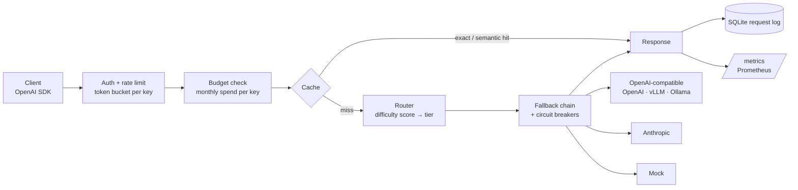

# Switchyard

[](https://github.com/rishikgbs04/switchyard/actions/workflows/ci.yml)

**A self-hosted, OpenAI-compatible LLM gateway.** Point any OpenAI SDK at Switchyard and every request gets cost-aware model routing, a safe semantic cache, automatic failover, per-key rate limits and budgets, and full cost/latency observability, with no application code changes.

```python
from openai import OpenAI

client = OpenAI(base_url="http://localhost:8080/v1", api_key="sk-dev-local")
client.chat.completions.create(model="auto", messages=[{"role": "user", "content": "..."}])
```

## Why

Teams shipping LLM features hit the same problems: every request goes to the most expensive model "to be safe", identical questions are paid for again and again, one provider outage takes the product down, and nobody knows what each feature costs. Switchyard sits between your app and the providers and fixes all four in one place.

## Results

Offline benchmark on a 2,000-request synthetic, labelled workload (Zipf-distributed popularity, 50% one-off requests), reproducible with `python -m bench.run_bench`:

| Scenario | Cost reduction vs. always using the top model | Cache hit rate | Wrong cache hits | Success rate |
|---|---|---|---|---|
| Routing only | **85.1%** | n/a | n/a | 100% |
| Routing + cache | **90.3%** | 33.9% | **0.00%** | 100% |
| Routing + cache, cheapest model down | 84.9% | 33.9% | 0.00% | **100%** (automatic failover) |

### The semantic cache safety ablation

Naive semantic caching silently serves wrong answers. Embeddings score `"top 5 customers by revenue"` and `"top 50 customers by revenue"` at 0.92 cosine similarity, and long prompts sharing a template ("design a URL shortener…" vs "design a rate limiter…") look nearly identical. Measured on the same workload:

| Cache configuration | Hit rate | Hits that returned the **wrong** answer |
|---|---|---|
| Embedding similarity only | 43.9% | **48.2%** |
| + numeric-entity guard | 34.5% | 8.4% |
| + semantic matching only for short, code-free prompts | 33.9% | **0.0%** |

Switchyard trades ~10 points of hit rate for zero incorrect responses.

> These numbers come from mock models and a synthetic workload, so treat them as a demonstration of the mechanisms, not production figures. Router accuracy is 100% on this workload only because the labels are easy; measuring it properly needs real labelled traffic (see Roadmap).

## Architecture



| Component | What it does |
|---|---|
| `router.py` | Scores prompt difficulty from transparent features (length, reasoning keywords, code, math, conversation depth), maps it to a model tier, and orders candidates: target tier first, escalate up on failure before falling back down. Policies: `auto`, `cheapest`, `best`, or an explicit model. |
| `cache.py` | L1 exact cache plus L2 embedding cache, scoped by conversation context (system prompt + earlier turns), with numeric-entity and prompt-length guards. Skips high-temperature requests. TTL + LRU eviction. |
| `breaker.py` | Per-model circuit breaker: opens after N consecutive failures, half-opens after a cooldown. |
| `gateway.py` | The pipeline: budget → cache → route → call with fallback → log cost/savings. |
| `providers/` | Adapters for OpenAI-compatible APIs (covers vLLM, Ollama, Groq, Together…), Anthropic, and a deterministic mock for offline tests. |
| `store.py` | SQLite (WAL) log of every request's routing decision, tokens, cost, savings and latency. Powers budgets and `/v1/stats`. |
| `metrics.py` | Prometheus exposition: request counts, fallbacks, cost, and a latency histogram per model. |

## Quickstart

```bash
pip install -e ".[dev]"
python -m switchyard          # runs on :8080 with offline mock models, no API keys needed
pytest -q                     # 22 tests
python -m bench.run_bench     # reproduces the results table
```

With Docker (gateway + Prometheus): `cp config.example.yaml config.yaml && docker compose up`.

To use real models, uncomment the provider entries in `config.yaml`, set current prices, and export `OPENAI_API_KEY` / `ANTHROPIC_API_KEY`.

## API

| Endpoint | Purpose |
|---|---|
| `POST /v1/chat/completions` | OpenAI-compatible chat. `model` can be a model name or `auto` / `cheapest` / `best`. |
| `GET /v1/models` | Configured models and routing policies. |
| `POST /v1/route/explain` | Dry run: difficulty score, features, and candidate order, without calling a model. |
| `GET /v1/stats` | Requests, spend, savings, cache breakdown, p50/p95/p99 latency, per-model usage, breaker states. |
| `GET /metrics` | Prometheus metrics. |
| `GET /healthz` | Liveness. |

Every response carries `x-switchyard-model`, `x-switchyard-cache`, `x-switchyard-attempts`, `x-switchyard-cost-usd` and `x-switchyard-difficulty` headers.

## Roadmap

- [ ] **Learned router.** Train a classifier on public pairwise-preference data (e.g. Chatbot Arena) to predict when a small model's answer is good enough; evaluate quality-vs-cost curves against the heuristic and against always-large.
- [ ] **Real-model eval.** Run a benchmark suite (e.g. MMLU / GSM8K / MT-Bench subsets) through each policy with real providers and report accuracy retained vs. cost saved.
- [ ] **Streaming** (`stream: true`, SSE) with time-to-first-token metrics.
- [ ] **Redis backend** for cache, rate limits and breakers so multiple replicas share state.
- [ ] **Dashboard** for spend, savings and routing decisions over time.
- [ ] **Deployment**: public demo on Fly.io / Render with a Grafana board.

## License

MIT
